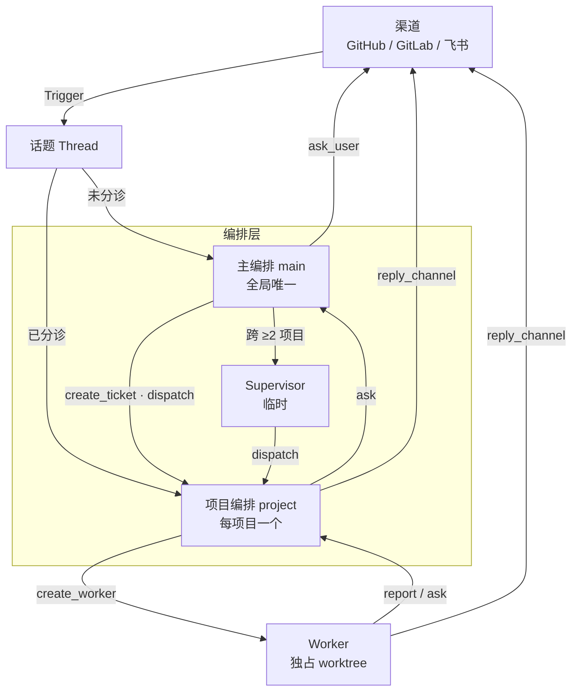
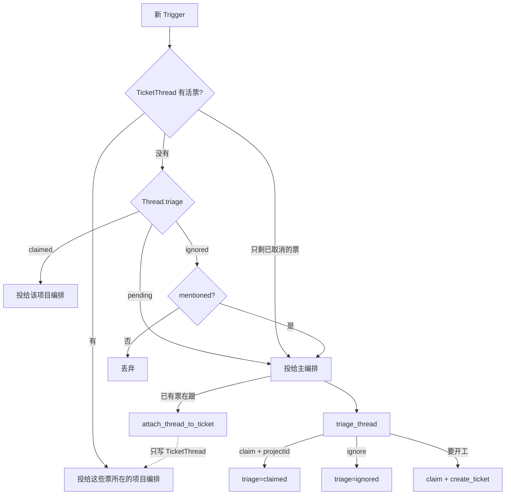
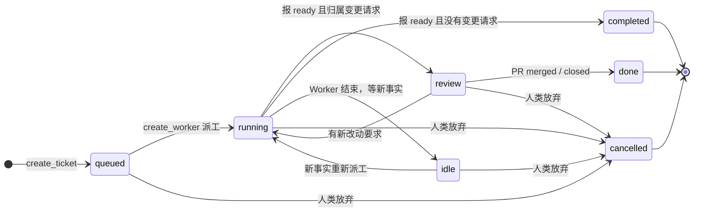
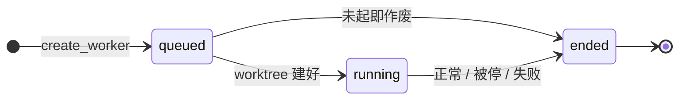
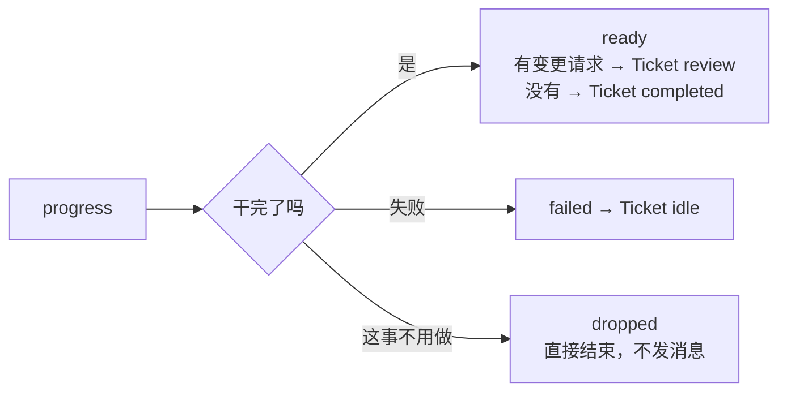
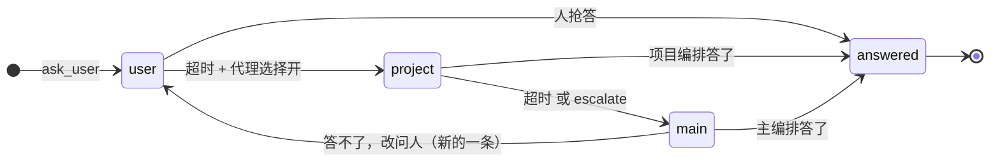
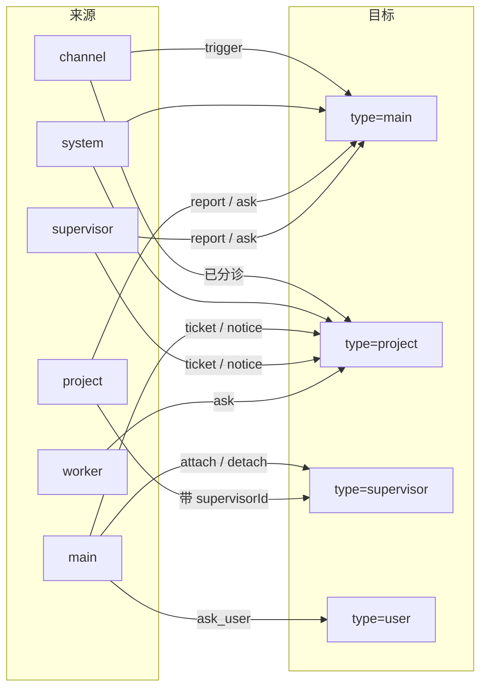
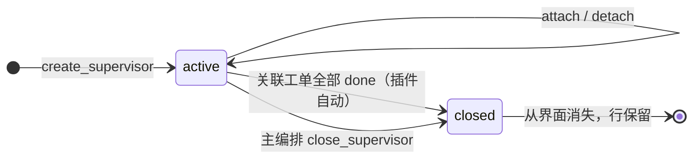
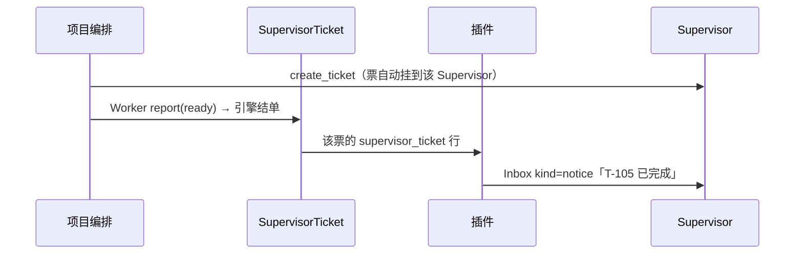
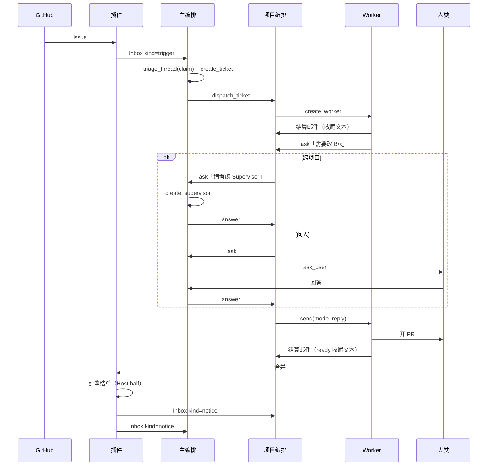

# 流程图

Supermesh 的完整流转。状态名、字段名取自 `prisma/schema/`，代理的工具与提示词见 [agents/](agents/README.md)。
**这里只讲跨代理的机制**，单个角色怎么用工具不在本文重复。

1. [全景](#1-全景) · 2. [触发与分诊](#2-触发与分诊) · 3. [任务生命周期](#3-任务生命周期)
4. [Worker](#4-worker-生命周期) · 5. [汇报与求助](#5-汇报与求助) · 6. [收件箱](#6-收件箱投递规则)
7. [Supervisor](#7-跨项目-supervisor) · 8. [PR 与 CI](#8-触发点pr-与-ci) · 9. [时序](#9-端到端时序) · 10. [速查](#10-状态速查表)

---

## 1. 全景



`main` / `project` / `worker` / `supervisor` 既是 `Inbox.type` 的取值，也是四个代理在库里互相指代的名字。

---

## 2. 触发与分诊

### 项目范围

当前设置页仅演示界面与本地交互，真实启动扫描、工作区同步、数据库更新和后台限制尚未接入。下述项目发现与启用范围是后续实现约定，不代表页面操作已改变运行中的插件。

项目应从已有工作区中发现，仅将目录存在、属于有效 Git 工作区且配置了 remote 的工作区纳入候选；无 remote、不可用和非 Git 工作区默认排除。启动及手动刷新只同步工作区元数据，不重置勾选，不删除失联历史；失联及不再符合候选条件的历史项目保留，但设置列表默认不展示。`workspaceId` 唯一，名称只是显示名；仓库托管平台与仓库路径从 `remoteUrl` 识别，Project 不保存渠道关联。`remoteUrl` 为兼容历史仍可为空，设置页采用紧凑列表且不展示 remote 地址。

`Thread.projectId` / `Thread.project` 和 `Project.threads` 是保留的话题分诊关系，与项目的 Git 身份无关。例如飞书话题可以由 `triage_thread` 分诊给任一已启用的 Git 项目，未分诊时 `Thread.projectId` 可以为空。

后台接入后，路由和动作入口在解析订阅或话题归属后，都应检查目标项目 `enabled`。禁用不删除历史、不撤销话题归属或订阅；停止对该项目的新自动分诊、建票、派工、建 Worker、消息投递与渠道出口。在途回合不强制中断，结束后不自动续跑。不能将禁用项目的现有订阅静默转派给别的项目。

**两件事分开**：`TicketThread`（哪些票跟着）决定投递，`Thread.triage`（归哪个项目）决定归属。



**人叫停的票不占话题。** 订阅行保留，但那条线已经停了：既不投递，也不借订阅唤醒。
只剩已取消的票跟着时，人的消息回主编排重新分诊 —— `triage_thread` 和 `create_ticket` 都不再被它挡住；
机器人和 CI 在那里只是上下文，不叫醒任何人。

**所有没票跟着的新话题都先进主编排**（分支 CI 除外，见 8.5）。它是唯一做归属判断的地方。

采集侧记录话题时就按仓库写入 `Thread.projectId`：仓库唯一对应一个启用项目时直接绑定，
触发邮件同时带上这个项目（`Inbox.projectId`）和归一化后的仓库名（`thread.repository`）。
主编排据此分诊，不必拿仓库名和 `projects[].remoteUrl` 比对大小写；`thread.project` 为空
就是「没有启用项目对应这个仓库」的服务端事实。绑定只写归属、不改 `triage`，路由不变。

**同一条消息会被编辑。** 触发按「话题 + 事件 id」落库，重读时用最新正文、点名和时间覆盖同一行。
人先发评论、再补一句 `@bot` 是常见写法，停在旧判定上会让建票和回复两道闸一起把人挡在外面。

### 为什么 attach 不写 `triage`

attach 只加一条订阅，`unlink_thread` 只删一条订阅。写 `triage` 会让两者不对称：
摘除时没人记得原值，话题就成了「订阅没了、路由还在」的孤儿 ——
消息继续投给 A 项目，A 查不到任何票跟着它，于是当新活，在自己的项目里给别人的仓库开 worktree。

副作用是合理的：一条话题可以同时被两个项目的票跟着，消息投给两处，各自决定怎么办。

---

## 3. 任务生命周期



阶段按事实落库，不由会话写：`queued`（还没派工，或有一个待启动的 Worker）→ `running`（Worker 在跑）
→ `idle`（跑过一轮、Worker 已结束，等新触发）或 `review`（报 `ready` 且票归属某个变更请求）
→ `done` / `completed` / `cancelled`。

**`ready` 的落点看有没有变更请求。** `prUrl` 或任一 PR 话题都算归属：有就进 `review` 等人审，
没有就是正常完成，直接 `completed` —— 没有 PR 可审的票不该停在 `review`，也不该退回 `idle` 等一个不会来的触发。

**没有 `draft`。** 任务一旦存在，`projectId` 就必须确定 ——「还没想好归谁」属于话题分诊。

**没有 `attention`。** 工单可以一边 `running` 一边等人，覆盖 `status` 会丢掉它跑到哪一步。
「需介入」是派生的：存在指向它、`kind=ask`、`status=pending` 的 `Inbox`。
派工失败同理，记在 `prepareError` 上，不占状态位。

### 暂停是 `paused` 开关，不是 `status` 取值

`paused` 与 `status` 正交：它不是第六种状态，而是叠加在任意未终态上的一道闸。

```
暂停时：不派工、不建新 Worker、不投递、不出口。
       源话题继续记录 trigger。
       正在跑的回合不打断（打断会留下半成品），跑完不重开。
解除：回到本来的 status，重新参与派工。
```

**暂停不阻止事实结单。** PR 合并 / 关闭是外部事实，与「要不要继续派工」无关：
`prState` 到终态时照常推成 `done`。让暂停挡住结单，票会永远停在 `idle`，
而它指向的改动早已在 main 上 —— 这是虚报「还有活」。

### 孤儿票：`prUrl` 永远为空的票

同一话题被并发建出两张票时，后一张拿不到 PR（PR 只能挂一张）。
Worker 报 `ready` 且没有变更请求时票直接 `completed`，不再需要人手工收掉；
根治仍在建票侧：`create_ticket` 必须对同一 `threadId` 串行。

### 任务之间的关联

| kind | 影响 | 谁写 |
| --- | --- | --- |
| `depends` | `relatedId` 没做完，`ticketId` 停在 `queued` | 同项目 `project` 的 `link_ticket`；跨项目 `supervisor` 的 `link_dependency_ticket` |
| `relates` | 无 | 同上 |

`depends` 的第二个作用：`relatedId` 到终态时**系统自动通知 Supervisor**（见第 7 章）。
同项目内没有 Supervisor，通知静默 —— 但**依赖约束照常生效**，由 `project` 自己看 `list_ticket`。

---

## 4. Worker 生命周期



`branch` / `worktree` 记录 Worker 的分支和工作树，`ended` 后仍保留。**派工必须落在工作树里**：
`branch` / `worktree` 缺失时插件补建，建不出来就整票退回 `queued` 并留 `prepareError`，
绝不降级到项目主 clone —— 那等于让多个 Worker 抢同一个 checkout。

应用重启时，仍在运行且会话可恢复的 Worker 沿用原会话和派工时间。空闲时向原会话发送恢复提示。

| `WorkerEndReason` | 编排动作 |
| --- | --- |
| `completed` | 看 `reportState` 定任务状态 |
| `stopped` | 任务回 `idle` |
| `failed` | 回 `idle`，或转人工 |
| `restarted` | 回 `idle`，自动重开 |

**重开必须重新投递**：`queued → running` 每一轮都用新的 requestId 投 prompt。
会话控制器按 rpcId 去重，复用同一个 id 会让重派工被静默吞掉 —— worker 置 `running`、会话里却什么都没有。

**`idle` 不自动重开**：worker 结束后回 `idle` 是等新事实（评论、`retry_ticket`、编排 `send`），
拿同一份 prompt 反复重派只会让票在 `idle` / `running` 之间空转。

**派工只由 `create_worker` 发起。** 从没派过工、也没有未完成 `depends` 的 `queued` 票，插件只往项目编排的收件箱
投一条「可以派工」的通知（同一张票只投一次），不建会话、不建工作树；分支名由编排给，工作树由插件保证。

### 汇报状态

`reportState` 是结构化通道，和会话正文（`view` 读的）是两回事。
Worker 跑完时，插件把它最后一条消息写进项目编排的收件箱，会话里只收到一条紧凑通知；
`report` 本身只写票面状态，不写 Inbox。



「我在等答复」归 `ask`，不占状态位。`dropped` 是「什么都不做」的合法表达 ——
没有它，Worker 遇到复现不了或已被别人修好的活，只能谎报 `ready` 或白问一次人。

---

## 5. 汇报与求助

**人类也是一个收件人。** 把 `type=user` 放进 `InboxTarget` 之后，「问人」和「问上级」是同一件事的两种取值。

```
worker     → project
project    → main          （给 supervisorId 则 → supervisor）
supervisor → main
main       → user（ask_user）
```

各角色工具的参数差异见 [agents/README.md](agents/README.md#汇报与求助)，不在这里重复。

### 升级：就地改 `type`，不新建记录



一个问题只有一条记录、一个身份，任何时候只有一个处理者。
每次升级更新：`type` 改上一级、`escalations+1`、`lastEscalatedAt=now`、
`deadline` 重置（升到 main 则置空）、`status` 保持 `pending`。

**只有从 `user` 升级出去的那一次要回渠道补一句话** —— 因为只有 `type=user`
意味着问题已经问出口了。

---

## 6. 收件箱投递规则



三条边界：`type=user` 只有 main 能写；`type=supervisor` 只有 main 和 project 能写；
**Worker 没有收件箱**，上级的话直接 prompt 进会话。
**Worker 的 `report` 也不走 Inbox**：跑完的收尾文本作为一条 notice 进项目编排的收件箱。

**编排会话只收紧凑通知。** 所有投给主编排 / 项目编排 / Supervisor 的消息——渠道触发、Worker 结算、
答案回传、Supervisor 开场——都先落成 Inbox 行，会话里只出现一条「你有 N 个未处理邮件」，
正文由 `read_mailbox` 按需读取。渠道正文不再以会话消息的形式再铺一遍。

### 三个状态

| `status` | 含义 | 进「N 条未处理」吗 |
| --- | --- | :-: |
| `pending` | 还没轮到 | ✅ |
| `done` | 处理完了 | — |
| `stalled` | **投递卡住**：重试 N 次都失败 | ❌ 单独显示 |

`stalled` 不是「没轮到」，是「送不到」。混进未读数会让人以为消息还在排队。
退避 2s → 4s → … → 封顶 60s，连续失败 3 次转 `stalled`。

**Worker 这一轮结束了不等于会话没了。** `worker.status = ended` 只表示当前回合跑完，
票还在等答案时这就是常态：投递侧会把 Worker 重新拉起来（记录回 `running`、票回 `running`），
答案照常送进它的会话。只有会话已经归档、再也解析不出来时，才改投它所属项目的编排
（`kind=notice`，并写明退回原因）—— 那条答案对人仍然有用，烂在队列里等于丢了。

答案交出去（送进会话或改投）就写 `answerRelayedAt`，投递队列按这一列为准。
不能按「有没有 answer」扫：答案一写下就是 `done`，那样每一轮都会把历史上答过的 ask 重投一遍。

对外回复彻底送不出去（重试到上限转 `stalled`）时会另投一条 `supermesh:reply-failed:<id>` 邮件
给它的编排：`reply_channel` 只回 `queued`，人不会知道那条评论其实没发出去。

### 已读与顺序

`readAt` 记「会话把它取进上下文的时刻」，和 `status` 分开：
`pending` + 空 = 还在队列；`pending` + 有值 = 看到了没处理完；`done` = 处理完了。
票结束时，`pending` 且 `readAt` 为空的消息**退回**，重新投给接手的人。

同一票对同一地址按 `seq` 顺序发：前一条没成功，后一条等着。不同票之间不等 ——
没有它，Worker 先回的「收到」可能比半小时后的「改好了」后到。

会话结束或空闲时，框架数一下自己名下 `status=pending` 的条数提示「你有 N 条消息未处理」。
**超时检查不靠后台定时器**，和这次提示共用同一次会话钩子。

---

## 7. 跨项目 Supervisor



**两条收口语义都不需要会话动手** —— 全部 done 是插件推导的，强关是主编排的决定。
有票 `cancelled` 不走自动关，只通知主编排。完整规则见
[supervisor.md](agents/supervisor.md#收工)，这里只讲唤醒与兜底。

### 唤醒：四个来源

| 来源 | 触发 |
| --- | --- |
| 主编排 | `create_supervisor` / `attach` / `detach` / `close` |
| 项目编排 | `report` / `ask` 带 `supervisorId` |
| 系统兜底 | 监督下的票进终态（见下） |
| 自动关停 | 关联票全 `done` 且收件箱无 pending → 直接关，**不叫醒** |

### 兜底：监督下的票进终态自动通知



**为什么需要**：跨项目协调里，supervisor 往往靠「这张做完了」才能派下一张。
漏掉这条通知，整条链路停在原地却不报错 —— 票是 done 的，谁也不知道还有个项目没动。

判据是**票归谁**，不要求两票之间有 `depends`：
`depends` 只表达先后约束，而通知要覆盖「协调中任何一个子任务结束」这个事实。

自动关停同样守着这条：关联票全 `done` 但收件箱还有 pending，就不收工。

---

## 8. 触发点：PR 与 CI

### 8.1 PR 上的事件

| 事件 | `TriggerKind` | 走触发？ |
| --- | --- | :-: |
| PR 打开 | `open` | ✅ |
| 对话区 / 行内评论 | `comment` | ✅ |
| Review（含无正文的通过打回） | `comment` | ✅ |
| CI 变化 | `ci` | ✅ |
| **合并 / 关闭** | — | ❌ 引擎直接结单 |

**Review 没写正文但点了 Approve 也要发** —— 点 Approve 本身就是答复，
吞掉它，等审批的 Worker 就永远等不到。

PR 和 issue 共用编号，但**话题不同**：issue 是 `github:42`，PR 是 `github:88`。
GitLab 编号是项目内递增，话题键要带项目：`gitlab:a/x:!42`。

**GitLab 最低支持 11.3.5。** 客户端只用 11.3.5 就存在的端点与参数：
`projects/:id`、`issues` 与 `merge_requests` 的 `state=all`/`scope=all`/`updated_after`/`order_by`、
`/notes`、`pipelines?ref=`（8.11 起）。鉴权固定用 `PRIVATE-TOKEN` 头 ——
11.3.5 不认 `Authorization: Bearer`，部分自建实例会直接 401。
issue 与 MR 的 `web_url` 随版本变化，三种形态都要能解析：
11.3.5 是 `/<ns>/<proj>/issues/:iid`（**没有** `/-/`），较新版本是 `/<ns>/<proj>/-/issues/:iid`，
最新是 `/-/work_items/:iid`。我们对外生成链接统一用 11.3.5 的旧形态 ——
新版会 301 到 `/-/`，反过来把 `/-/` 写到 11.3.5 上是 404。

### 8.2 PR 归谁处理

| 情况 | 谁处理 |
| --- | --- |
| 已绑定工单 —— 评论 / review | Worker |
| 已绑定工单 —— CI | 项目编排 |
| 已绑定工单 —— 合并 / 关闭 | 引擎结单 |
| **没绑定** | 走触发 → 主编排分诊 |

**主编排只在没有归属时出场。** 已绑定 PR 的任何事件都不经过它。

### 8.3 合并 / 关闭：引擎结单

```
PR 合并 / 关闭 → closePull → threadClosed(thread, outcome, at)
  → 引擎直接 end(ticket)                    ← 结单在这里
  → emit('ticket.ended')
      ├─ 主编排收件箱 kind=notice            ← 只是通知
      └─ 代码托管渠道以外补一句话            ← GitHub/GitLab 时间线已有
```

三个关键点：

**① 结单是引擎做的。** 编排收到的是通知，不是「请你处理」。

**② `unfinished` 例外。** Worker 还有没报 `ready` 的活，或 PR 关后又起了新 Assignment
→ **不结单**，等 `ready`。防止「PR 合了但活没干完」被误判完成。

**③ `followsDone`：关注的话题全关才结单。**

我们的等价实现放在**渠道插件**（Host half）—— **Host 代码，不是代理工具**：

```
1. 按 TicketThread 找跟进这张 PR 的工单
2. 检查 unfinished
3. 没有 → 写 prState + status=done + endedAt
4. 有   → 只记 prState，留 review，等 report(ready)
5. 主编排 + 项目编排各投一条 kind=notice
6. 代码托管渠道以外发一句话；GitHub / GitLab 上不发
```

**为什么不走触发**：PR 合并时没有要判断的东西 —— 结论已经在代码托管平台上了。
走触发等于让编排重复确认一件已确定的事，还多一个「忘了处理就永远不关」的失败点。

### 8.4 PR 归哪张工单

挂票只认 **Worker 会话自己的 shell 证据**。分支名不参与匹配。

| 证据 | 从哪来 | 绑定来源 |
| --- | --- | --- |
| `gh pr create` 打印的 PR 地址 | 官方 `forgeSession` 的会话投影 | `created` |
| `gh pr view` / `edit` / `checkout` 选中的 PR | 同上 | `referenced` |
| `git push` 之后按被推分支反查打开的 PR | 同上（`forge.findByHead`） | `discovered` |
| `glab mr create` 打印的 MR 地址 | 插件读 Worker 会话的 `tool/result` | 直接挂票 |
| `git push` 之后按 `source_branch` 反查打开的 MR | 插件查 GitLab API | 直接挂票 |

Worker 回合结束时插件把证据里的地址写进票的 `prUrl` 并订阅那条 PR 话题；
采集侧随后按 `prUrl` 反查就能接回票，合并 / 关闭照常推成 `done`。
运行时启动后还会给 `idle` / `review` 里 `prUrl` 为空的票补挂一次，历史票因此能自己收尾。

### 8.5 两套 CI

| | 合并请求 CI | 分支 CI |
| --- | --- | --- |
| 看谁 | open ticket 的 PR / MR | 默认分支 head |
| 话题 | 跟 PR 共用 | **独立**（`github:ci:main`） |
| 能回复 | ✅ | ❌ **没有地址** |
| 开关 | 无条件 | 渠道开关，默认关 |

**防抖与渠道无关**：两套都用 `CiWatch.fingerprint` 记住上次快照，指纹变了才发。
各渠道数据形状不同（GitHub 是 `check-runs`，GitLab 是 `pipeline`），但算完都归到同一个字段 ——
**算法归渠道，表不关心它长什么样**。

两条最容易漏的规则：

- **首次只建基线，不发。** 没有它，每接一张新任务，第一次轮询都会因为「和空值不同」误报一次。
- **分支 CI：还有 check 在 running 就假装失败集合没变。** 没有它，跑到一半时
  「3 个失败」→「2 个失败」→「1 个失败」会连触发三次；有了它，恢复只在全绿后报一次。

失败判定：`failure` · `timed_out` · `cancelled` · `action_required` · `startup_failure` · `error`
（check-runs 看 `conclusion`，旧式 status 看 `state`）。

**投递**：PR CI 跟 PR 的 `triage` 走；分支 CI 直接投项目编排 —— 仓库已注册为项目，归属确定。

### 8.6 分支 CI 不能回复

分支 CI 的话题根本没有 channel 字段。`reply_channel` 拿到 `ThreadKind=ci` 的触发必须
**明确报错**，不能猜一个地方发。

---

## 9. 端到端时序



**同话题追加消息不经过主编排**：`TicketThread` 已有活票跟着，直接投给该项目编排 ——
分诊已完成，不该被同一件事反复叫醒。人叫停的票不算：那条线已经停了，那里的新活要重新分诊。

---

## 10. 状态速查表

| 枚举 | 取值 |
| --- | --- |
| `ThreadKind` | `issue` · `pull` · `chat` · `ci` |
| `ThreadTriage` | `pending` · `claimed` · `ignored` |
| `TriggerKind` | `comment` · `open` · `close` · `ci` · `push` |
| `TicketStatus` | `queued` · `running` · `idle` · `review` · `done` · `completed` · `cancelled` |
| `PullRequestState` | `open` · `merged` · `closed` |
| `CiState` | `pending` · `running` · `passing` · `failing` |
| `TicketLinkKind` | `depends` · `relates` |
| `WorkerStatus` | `queued` · `running` · `ended` |
| `WorkerEndReason` | `completed` · `stopped` · `failed` · `restarted` |
| `ReportState` | `progress` · `ready` · `failed` · `dropped` |
| `InboxTarget` | `user` · `main` · `project` · `supervisor` |
| `InboxOrigin` | `channel` · `main` · `project` · `worker` · `supervisor` · `system` |
| `InboxStatus` | `pending` · `done` · `stalled` |
| `InboxKind` | `trigger` · `ticket` · `ask` · `notice` |
| `InboxAnsweredBy` | `user` · `main` · `project` · `supervisor` · `worker` |
| `SupervisorStatus` | `active` · `closed` |

### 派生状态

| 想要 | 怎么算 |
| --- | --- |
| 任务需介入 | 存在指向它、`kind=ask`、`status=pending` 的 Inbox |
| 收件箱未读数 | `type=自己 AND status=pending` 的 count |
| 已升级的 ask | `escalations > 0` |
| Supervisor 自动关停 | 关联工单**全部 `done` / `completed`** 且收件箱无 pending → 插件写 `closed` |
| Supervisor 待主编排决定 | 关联工单里有 `cancelled` → 只投 notice，不自动关 |
| 某票是不是某 Supervisor 的 | `SupervisorTicket` 有记录 |

`closed` 和票的状态同源：**都是事实推出来的，不是谁调用的结果。**
这也是 `close_self`、`update_ticket` 被删掉的原因 —— 让会话去写一个库里早就能算出的值，
只会多一个漏判的机会，不会多一分准确。
